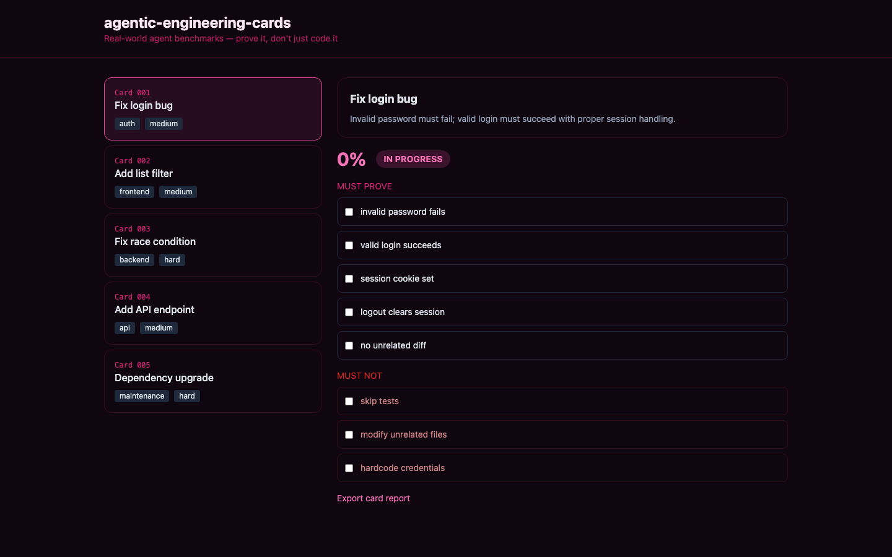

# agentic-engineering-cards

> Real-world benchmark cards for AI coding agents — prove tests, side effects, and rollback readiness.

**Topics:** `ai-agents` · `benchmarking` · `agentic-ai` · `coding-agents` · `evaluation` · `llm` · `software-engineering`



## Cards

- Card 001: Fix login bug (session, logout, no unrelated diff)
- Card 002: Add filter (API + UI + pagination)
- Card 003: Fix race condition
- Card 004: Add API endpoint
- Card 005: Dependency upgrade

## Quick Start

```bash
npm install
npm run dev      # http://localhost:3108
npm test
```

## License

MIT — see [LICENSE](LICENSE).

## Author

**Mehmet Turac** — [github.com/mturac](https://github.com/mturac)
